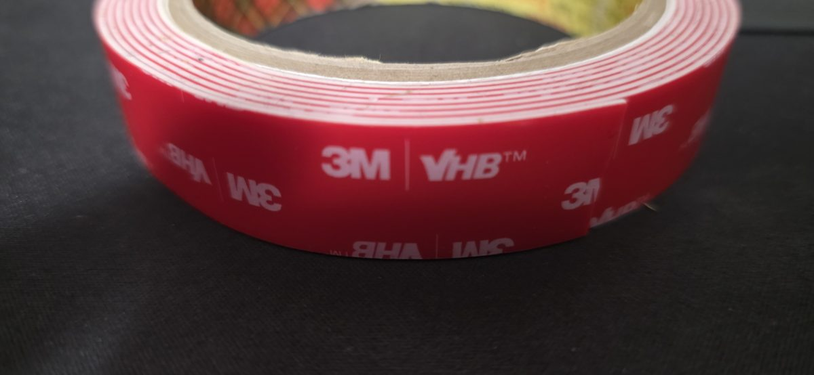
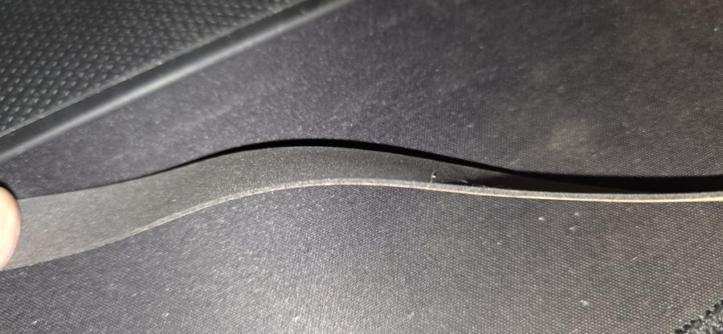

# Build the BEStie board for BoschData

**The main version of this guide, with photos, is on my site:
[lagorai.bike/extensions/boschdata/board/](https://lagorai.bike/extensions/boschdata/board/).**
This copy stays here next to the code.

The board is what makes BoschData work every ride without touching anything: it
stays paired with the bike, the bike reconnects to it by itself every time you
switch it on, and the Karoo reads the board. No soldering, about an hour the
first time, most of it waiting for parts.

What I use, and the only setup I have tested: an Adafruit Feather nRF52840
Express with a 500 mAh LiPo, in a small printed case, stuck to the bike.

## 1. What to buy

| Part | What it is for |
|---|---|
| **Adafruit Feather nRF52840 Express** (Adafruit product 4062) | The board: Bluetooth chip, USB port, LiPo charger, battery connector. Take the *Express*: the bootloader below is for that exact model. |
| **LiPo battery, 1 cell 3.7 V, 500 mAh, JST-PH 2.0 plug** | Powers the board for weeks. Mine is a 562438 size (about 5.6 × 24 × 38 mm), which fits the case. **Check the polarity** before plugging it in (section 3). |
| **Micro-USB cable** that carries data, not a charge-only one | Flashing the firmware and charging the LiPo. |
| **Case** (optional) | My slim printed case, files in [`hardware/slimcase`](../hardware/slimcase). |
| **3M VHB double-sided tape** (the red-liner foam tape) | Holds the board and its LiPo together. |
| **Very thin adhesive foam** | Inside the case, against vibration; and on the outside, where the case rests on the frame, against scratches. |
| **An elastic strap** | Holds the case on the frame: it weighs very little. |
| A computer with **Chrome** (or another Chromium browser) | The web page that updates the bootloader. |
| Your phone with the **Bosch Flow** app | Pairing the board with the bike, once. |

What I paid in Italy in November 2026, VAT included: the Feather 28.05 € (plus 7.92 € shipping), the LiPo 11.87 €, the printed case about 14 € plus shipping.

And of course: a **Karoo 3** with BoschData, and a **Bosch Smart System** bike with
the Live Data Interface (control unit firmware v19 or later, CX Gen4, CX Gen5,
SX). In Flow, your bike must offer adding a new device (Italian app: "Aggiungi nuovo dispositivo").

## 2. The case (or no case)

The case is two snap-fit shells, no screws: 59.9 × 33.0 × 20 mm assembled, 3 mm
walls, an opening on the short side for the USB cable, so you charge without
opening it. The STL files and the script that makes them are in
[`hardware/slimcase`](../hardware/slimcase).

- I had it printed by an online service in Nylon PA12 (MJF). Any service that
  prints PA12 should do; the files pass the 1.5 mm minimum wall checks.
- Honest note: with these files the lid closes, but **hard**. The case README
  says what to change for a reprint (smaller ridge, more play).
- Inside: the case lined with the thin foam, the LiPo, and the board on top of
  the LiPo held by the VHB tape, the **USB end** of the board at the opening. The LiPo goes under the
  USB half of the board; the other end, with the antenna, stays free.

**No case?** The board works the same in any small box or pouch that keeps
water and mud out. Keep metal away from the antenna end (the end opposite
the USB port) and do not let the bare board touch anything conductive.

## 3. Battery and charging

1. **Polarity first.** Next to the battery connector the Feather has `+` and `-`
   marks. The red wire of the LiPo must go to `+`. LiPo packs sold online come
   wired both ways: if yours is reversed, swap the two pins in the plastic
   plug (lift the little tab, pull the wire out, put it in the other slot)
   before plugging it in. A reversed battery can destroy the board.
2. Plug the LiPo into the board.
3. Charge from any USB charger or computer through the micro-USB port. The
   small charge LED next to the USB port is on while it charges.

The board runs from the LiPo and charges from USB at the same time, so you can
leave it plugged in while flashing.

## 4. Flashing the firmware

The firmware is my fork of the open-source [BEStie](https://github.com/bestie-org/BEStie)
firmware (GPL-3), with one addition: a small Bluetooth service the Karoo reads.
Download from the [firmware release](https://github.com/anpaiss/BEStie/releases/latest):

- `bestie_nrf52840_feather_karoo.uf2`: the file to drag onto the board (easiest);
- `bestie_nrf52840_feather_karoo.hex`: the same firmware for the web uploader.

### 4.1 Enter the bootloader

Plug the board into the computer with USB. Press and hold **both** buttons,
release **RESET**, keep holding the other one until a USB drive appears called
`FTHR840BOOT`, with `CURRENT.UF2`, `INDEX.HTM` and `INFO_UF2.TXT` in it.
Sometimes it takes two or three tries.

### 4.2 Check the bootloader

Open `INFO_UF2.TXT`. If it contains

```
SoftDevice: S140 7.3.0
```

the bootloader is fine: go to 4.4. Otherwise update it first (4.3): with an older
SoftDevice the firmware crashes at boot.

### 4.3 Update the bootloader (only if needed, once per board)

1. Download `feather_nrf52840_express_bootloader-v0.11.0_s140_7.3.0.hex` from the
   [BEStie bootloader release](https://github.com/bestie-org/Adafruit_nRF52_Bootloader/releases/latest/).
   Take exactly the `feather_nrf52840_express` one ending in `_s140_7.3.0.hex`:
   a bootloader for a different board can leave the board unable to start.
2. Open the [BEStie web uploader](https://bestie-org.github.io/adafruit-uploader/) in Chrome,
   with the board in bootloader mode (4.1).
3. **Connect Serial** (allow the page to use the USB device; there should be
   one port in the list), then **Single .hex (auto detect)**, pick the
   bootloader file, **Upload**.
4. When it says it is done, **wait 30 more seconds** (the board is still
   writing), then unplug and plug the USB again.
5. Enter the bootloader again (4.1) and check that `INFO_UF2.TXT` now says
   `SoftDevice: S140 7.3.0`.

### 4.4 Install the firmware

With the board in bootloader mode and the `FTHR840BOOT` drive open, **drag
`bestie_nrf52840_feather_karoo.uf2` onto the drive**. The drive disappears
when the copy ends and the board restarts with the new firmware.

Alternative: the web uploader as in 4.3, with `bestie_nrf52840_feather_karoo.hex`.

### 4.5 Check

Unplug and plug the USB again: **no drive must appear**. A drive means the
firmware does not start: check the bootloader (4.2) and flash again.

Optional, with the free **nRF Connect** app on a phone: a scan shows a device
called `BEStie`. Do not pair it from the phone; just look.

## 5. Pair the board with the bike (Bosch Flow, once)

1. Switch the bike on, board powered (LiPo plugged in).
2. In the Bosch Flow app: add a new device to the bike (Italian app: **Aggiungi nuovo dispositivo**) and pick **"BEStie"**, and
   confirm. In the bike's list of components the board then shows up as an
   external display called BEStie.
3. Close Flow. Switch the bike off and on again: from now on the bike finds
   the board by itself, with no phone.

## 6. Set up the Karoo

1. Install BoschData (see the [README](../README.md#install)) and open it.
2. If the "Bike:" line says the Bluetooth permission is missing, press
   **GRANT BLUETOOTH**.
3. Leave **Through the BEStie board** ticked (the default) and **BoschData ON** ticked.
4. With the board powered nearby, the "Bike:" line goes from
   `looking for the board 'BEStie' (fast)` to `board found, connecting…` to
   `board linked, bike UP, board batt NN %, …`. The Karoo remembers the board
   from then on.
5. Put the fields on a ride page, among them **BEStie battery** so you see
   when the board needs charging. Optional: Karoo **Sensors → add sensor →
   BoschData → Bosch eBike** for the rider power as a power meter.

## 7. Mount it on the bike

The board sits on its LiPo, held by 3M VHB double-sided tape, the one with the
red liner:



Inside the case, and on the outside where it rests on the frame, I put a very
thin adhesive foam: inside against vibration, outside so it does not scratch the
frame. The case goes on the frame with an elastic strap; it weighs so little that
it is all it needs.



Keep the USB opening reachable, so you charge without opening the case.

## 8. Does it work?

On the Karoo, with the bike on:

- the BoschData app says `board linked, bike UP, …`;
- the fields show values; with the bike off they show `--` and come back by
  themselves when you switch it on again;
- BEStie battery shows the board's %.

In the log (`/sdcard/Android/data/com.anpaiss.boschdata/files/bosch_data.log`)
the lines tagged `[BEST ]` are the Karoo–board link, `[STAT ]` the board's
status (bike up/down, counters), `[BRD  ]` the board's own log, replayed to the
Karoo: link up/down, pairing, bike up/down, each with a time.

My numbers:

- **Garage test, 10 November 2026**: 752 messages from the bike, none lost;
  data on the Karoo 3 s after switching the bike on; after the bike off and on
  again, the board reconnected it alone in 2–4 s.
- **First real ride, 15 November 2026**: board linked from 10:19 to 11:01,
  10,175 messages from the bike, 0 dropped, no reconnection needed. Bike battery
  100 → 90 %, written to the FIT file every 5 s (370 values). The bike odometer
  moved about 6 km, the same as Bosch Flow (6.0 km).

## 9. Battery life of the board

Rough numbers so far, from one board:

- Standby (bike off, board waiting): about 0.15–0.25 mA, which would be 2 to 3.5
  months on 500 mAh. Measured from the battery % over a few days, so take it
  as an estimate.
- Riding: 96 → 95 % in about 40 minutes linked to bike and Karoo, on the first ride.

The BEStie battery field turns red below 20 %: time to charge. I will update
these numbers as the rides add up.

## 10. If something does not work

| Problem | What to do |
|---|---|
| No `FTHR840BOOT` drive | Try the button sequence again; try another cable (charge-only cables do not show the drive). |
| After flashing, the drive comes back at every plug-in | The firmware does not start: the bootloader is not S140 7.3.0 (4.2–4.3), or the file is for another board. |
| "BEStie" not in Flow | Board powered? (LiPo charged, or USB.) Bike on? Check with nRF Connect that `BEStie` advertises. Close and reopen Flow. |
| Pairing in Flow does not complete | Remove BEStie from the bike's components in Flow, unplug and replug the LiPo, pair again. |
| The Karoo does not find the board | Board powered and within a few metres? BoschData ON and "Through the BEStie board" ticked? Bluetooth permission granted? The scan looks for the exact name `BEStie`. |
| The Karoo finds a board but says it has no BoschData service | The board runs the stock BEStie firmware: flash the Karoo build (4.4). |
| You changed board | **FORGET BOARD** in the app: the Karoo looks for a new one. Then pair the new board in Flow. |
| Fields stay `--` with the board linked | The app says `bike down`? Switch the bike on; if it stays down, the bike is not paired with this board (section 5). |
| The board keeps restarting (`boot #` grows in the status, `LAST FAULT` in the app) | Please open an issue with the log file attached. |

Not available: the **assist mode**. The current Bosch firmware does not send
it over the Live Data Interface; if a future update adds it, BoschData already
writes unknown fields to its log.

Questions, problems, or it works on your bike: [open an issue](https://github.com/anpaiss/BoschData/issues).
